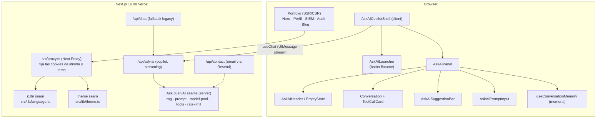
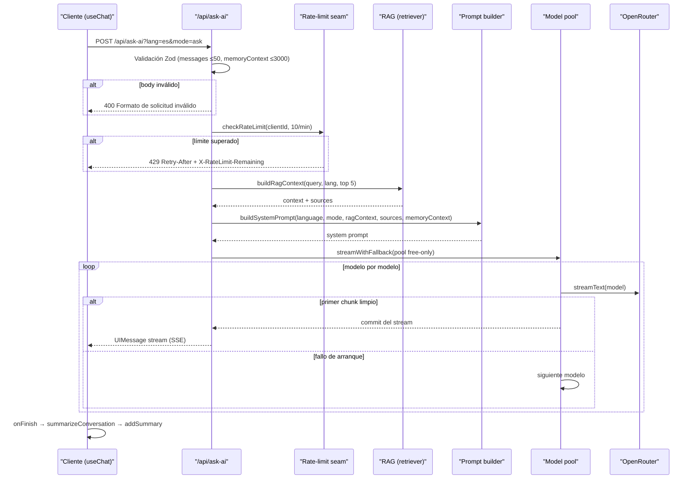
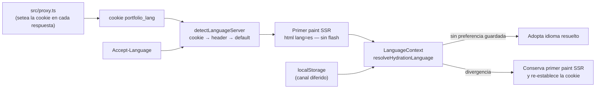
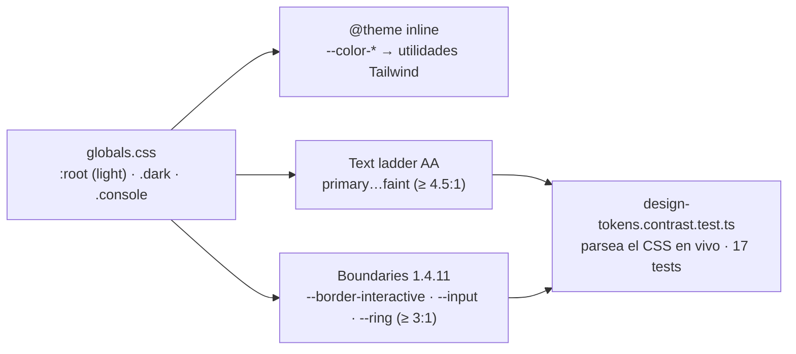
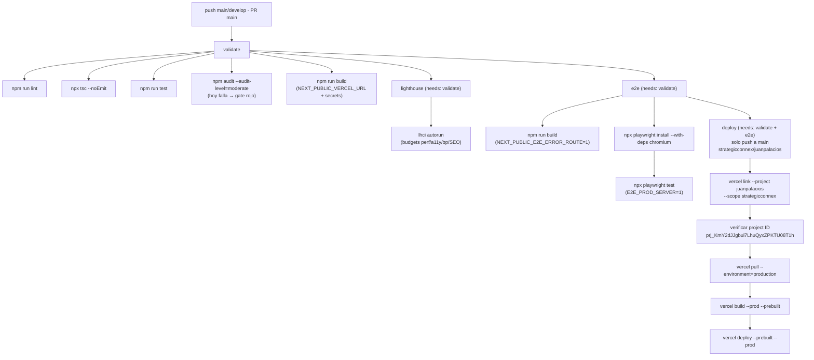

# Juan Felipe Palacios — Portfolio IT/OT

Portfolio de consultoría en **ciberseguridad industrial, IT/OT y redes para Oil & Gas** (Vaca Muerta, Neuquén, Argentina). Incluye un dashboard SIEM simulado, visualización del modelo Purdue, hub de compliance, sección de producto SaaS (StrategicAudit Pro), blog técnico y un **AI Cybersecurity Copilot bilingüe** con RAG del propio portfolio.

**URL de producción:** `https://juanpalacios.vercel.app`

---

## Stack Tecnológico

| Capa | Tecnología |
|---|---|
| Framework | Next.js 16 (App Router + Turbopack), React 19, TypeScript 6 |
| Estilos | Tailwind CSS v4, Framer Motion, Three.js + @react-three/fiber, tsparticles |
| AI | Vercel AI SDK v7 (`ai`, `@ai-sdk/react`, `@ai-sdk/openai`), OpenRouter, Streamdown (Markdown) + Shiki |
| UI | shadcn/ui, Lucide Icons, use-stick-to-bottom |
| RAG | Keyword scoring + TF-IDF cosine (fusionado, sin vector DB) |
| State | Zustand (UI), Context API (i18n), localStorage (persistencia) |
| Datos | Zod (validación), Resend (email) |
| Rate limiting | Upstash Redis + fallback in-memory |
| Observabilidad | PostHog (analytics), Sentry (errores), StrategicAudit RUM, telemetría del copilot (`ask_ai_*`: JSON a stdout + Sentry) |
| Testing | Vitest + Testing Library + axe-core (unit), Playwright (e2e), Lighthouse CI (perf · a11y · best-practices · SEO) |
| CI/CD | GitHub Actions (`validate` → `lighthouse` → `e2e` → `deploy`), Husky + lint-staged |

---

## Arquitectura General

```
┌──────────────────────────────────────────────────────────────────────┐
│ Browser                                                              │
│  ┌─────────────┐   ┌──────────────────────────────────────────────┐  │
│  │ Portfolio    │   │ AskAICopilotShell (client)                  │  │
│  │ (SSR/CSR)    │   │  ├─ AskAIErrorBoundary                     │  │
│  │ Hero, Perfil │   │  ├─ AskAILauncher (botón flotante)         │  │
│  │ Arquitectura │   │  └─ AskAIPanel                              │  │
│  │ Experiencia  │   │      ├─ AskAIHeader / EmptyState           │  │
│  │ SIEM, Audit  │   │      ├─ Conversation + ToolCallCard        │  │
│  │ SCAudit, Blog│   │      ├─ AskAISuggestionBar                 │  │
│  │ Stack, Certs │   │      └─ AskAIPromptInput                    │  │
│  │ Proyecto     │   │      └─ useConversationMemory (memoria)     │  │
│  └──────┬───────┘   └──────────────────┬─────────────────────────┘  │
│         │                              │ useChat (UIMessage stream) │
└─────────┼──────────────────────────────┼────────────────────────────┘
          │                              │
          ▼                              ▼
┌──────────────────────────────────────────────────────────────────────┐
│ Next.js 16 on Vercel                                                 │
│  ┌──────────────┐   ┌────────────────────────────────────────────┐  │
│  │ src/proxy.ts │   │ API routes                                  │  │
│  │ (Next Proxy) │   │  /api/ask-ai  (copilot, streaming)         │  │
│  │  - fija las  │   │  /api/contact (email vía Resend)           │  │
│  │    cookies   │   │  /api/chat   (fallback legacy → ask-ai)    │  │
│  │    de idioma │   └───────────────┬────────────────────────────┘  │
│  │    y tema    │                   │                               │
│  └──────┬───────┘                   ▼                               │
│         │                           │                               │
│  ┌──────┴──────────────┐  ┌─────────────────────────────────────┐  │
│  │ seams de UI         │  │ Ask Juan AI seams (server)          │  │
│  │ src/lib/language.ts │  │  rag/retriever.ts  (RAG unificado)  │  │
│  │ src/lib/theme.ts    │  │  rag/sources.ts    (corpus derivado)│  │
│  │ idioma · tema       │  │  rag/tokenizer.ts  (stop-words)     │  │
│  │ cookie → header →   │  │  prompt/system-prompt.ts (prompt)   │  │
│  │ default (ES/EN)     │  │  model-pool.ts       (fallback real) │  │
│  └─────────────────────┘  │  tools/registry.ts   (6 tools)      │  │
│                           │  rate-limit.ts       (Upstash+mem)  │  │
│                           └─────────────────────────────────────┘  │
└──────────────────────────────────────────────────────────────────────┘
```

**Versión Mermaid** (renderiza en GitHub):



### Seams (módulos profundos — ver `CONTEXT.md`)

| Seam | Módulo | Responsabilidad |
|---|---|---|
| **Detección de idioma** | `src/lib/language.ts` + `src/proxy.ts` | Regla única *cookie → Accept-Language → default*; el proxy garantiza `portfolio_lang` en cada respuesta de página (el layout no puede setear cookies en Server Components) |
| **Tema (theme)** | `src/lib/theme.ts` + `src/proxy.ts` | Misma regla que el idioma: cookie `portfolio_theme` → preferencia del SO → `light`/`dark`/`system`; el script no-flash del layout aplica el tema antes del primer paint |
| **Retrieval (RAG)** | `src/features/ask-ai/lib/rag/retriever.ts` | `retrieve()` fusiona keyword + TF-IDF (normalizados 0–100, pesos 0.6/0.4); contexto y lista de fuentes salen de la misma retrieval |
| **Tokenizer** | `src/features/ask-ai/lib/rag/tokenizer.ts` | `tokenize()` + `STOP_WORDS` (interrogativos ES/EN incluidos) |
| **Corpus** | `src/features/ask-ai/lib/rag/sources.ts` | Proyección derivada de `src/data/*` + traducciones (per-locale `es`/`en`, nunca `both` con contenido español). **174 entradas: 87 `es` + 87 `en`** (122 de ellas son la biblioteca `/recursos`, 61 por locale) |
| **Rate limit** | `src/lib/rate-limit.ts` | `checkRateLimit()` async: Upstash Redis con fallback in-memory; `getClientId()` lee la **última** IP de `x-forwarded-for` (ADR-001) |
| **Prompt builder** | `src/features/ask-ai/lib/prompt/system-prompt.ts` | `buildSystemPrompt()` + `buildToolDescriptions()` (templates bilingües, opción `memoryContext`) |
| **Model pool** | `src/features/ask-ai/lib/model-pool.ts` | `streamWithFallback()`: lee el primer chunk del stream antes de comprometerse (fallback real — `streamText` no lanza en la llamada); todo el pool falla → 503 |
| **Memoria** | `src/features/ask-ai/lib/memory/` | Client-side: `summarizeConversation` → `addSummary` en `onFinish`; `buildMemoryContext()` viaja en el body (cap 3000) y se embebe en el system prompt |
| **Panel privado** | `src/features/stats/panel-auth.ts` | Cookie de sesión HMAC-SHA256 (`panel_auth`, httpOnly, 30 días) emitida por `/estadisticas-privadas/sesion`; la clave de firma **es** `DOWNLOAD_STATS_TOKEN` (sin env configurada el panel responde 404) |
| **Registro de descargas** | `src/features/stats/download-stats.ts` | Backends Upstash Redis REST (durable en Vercel) o NDJSON local (`.data/descargas.ndjson`); log acotado a los últimos 10.000 eventos |
| **Biblioteca / recursos** | `src/features/recursos/recursos-volumes.ts` + `src/data/recursos.ts` | 61 documentos en 7 categorías: **5 volúmenes** con página de detalle (`/recursos/[volumen]`) + 2 colecciones sin volumen (estándares, proyecto). El texto se extrae con `scripts/extract-recursos-text.mjs` → `src/data/recursos-text.json` y alimenta el corpus del copilot |

---

## Flujo del AI Copilot (`POST /api/ask-ai`)

```
Cliente (useChat)  ──POST──▶  /api/ask-ai?lang=es&mode=ask
                                   │
                                   ▼
                       1. Validación Zod (messages ≤50, memoryContext ≤3000)
                                   │
                                   ▼
                       2. Rate limit: checkRateLimit(clientId, 10/min)
                                   │ 429 → Retry-After + X-RateLimit-Remaining
                                   ▼
                       3. RAG: buildRagContext(última query del usuario, lang, top 5)
                                   │  corpus proyectado per-locale
                                   ▼
                       4. Prompt: buildSystemPrompt({ language, mode, ragContext,
                                   │            sources, memoryContext })
                                   ▼
                       5. Model pool: streamWithFallback(pool free-only → 503 si todo falla)
                                   │  commit al primer stream que arranca limpio
                                   ▼
                       6. UIMessage stream (SSE)  ──▶  Cliente (streaming Markdown)
                                   │
                                   └─ onFinish → summarizeConversation → addSummary
```

**Versión Mermaid** (renderiza en GitHub):



### Pool de modelos (OpenRouter)

| Orden | Modelo | Env var |
|---|---|---|
| 1–6 | Pool **free-only** (`:free`, costo $0 — invariante en código) | `OPENROUTER_MODEL_POOL` |

El copilot **siempre usa modelos gratis**: no existe fallback pago. `buildFreeModelPool()`
descarta cualquier entrada que no termine en `:free` (o el router `openrouter/free`,
usado como red de seguridad al final del pool); si tras el saneamiento el pool queda
vacío, responde **503** en vez de gastar dinero. Un modelo cuenta como fallido solo si
su stream **falla al arrancar** (read rechazado, stream vacío, primer evento SSE
`{"type":"error"}` o 429 de rate limit). Errores mid-stream no se reintentan
(requeriría buffering). El modelo ganador viaja al cliente como metadata del stream
y el panel lo muestra con su **latencia percibida** (ej. `gemma-4-31b-it · 1.4s · gratis`).
Cuando el primer modelo del pool falló y respondió un modelo posterior, el badge se
marca en **ámbar con un icono de fallback** (con tooltip explicativo).
Si un stream se corta a mitad, el panel **reintenta automáticamente** (máx. 2 por
respuesta) con el siguiente modelo del pool, enviando `skipModels` (los ids que
fallaron mid-stream) para no repetirlos; si los skips vacían el pool, la ruta
responde 503.

Los modelos free de OpenRouter tienen rate limit (20 req/min por cuenta, límites
por modelo más estrictos), así que un **429 al arrancar el stream** no salta
directo al siguiente modelo: el modelo entra en una **cola de reintentos con
backoff exponencial** (±50% de jitter, 600ms → 1200ms, máx. 2 reintentos por
modelo) antes de avanzar, con un **presupuesto global de 5s** para que el pool
quede dentro del `maxDuration` de la ruta (30s). Solo al agotar los reintentos el
pool avanza al siguiente modelo.

El **health-check del pool se persiste en localStorage** (`ask-ai-failed-models`, con
TTL de 24h): los modelos que fallaron mid-stream en visitas anteriores arrancan
skippeados desde el primer mensaje de la siguiente visita. La lista se auto-cura:
cada fallo nuevo desliza el reloj del TTL, y un modelo que dejó de fallar se
vuelve a probar al expirar su entrada (los rate limits de los free se resetean
a diario).

### Herramientas (pasivas)

`dnsAnalyzer` · `sslChecker` · `httpHeadersAnalyzer` · `whoisLookup` · `techStackDetector` · `portAnalyzer` — todas con Zod schema, `safe-fetch` (bloqueo de IPs privadas/SSRF) y tarjetas de resultado dedicadas en `src/features/ask-ai/components/ask-ai/tools/`.

---

## Skeleton del Proyecto

```
src/
├── proxy.ts                      # Next 16 Proxy: garantiza cookie de idioma y de tema
├── test-setup.ts                 # Setup global de Vitest (jsdom + jest-dom)
├── lighthouse-budget.test.ts     # Guard del presupuesto de Lighthouse (lee lighthouserc.json)
├── app/                          # Rutas (componen features; sin lógica de dominio)
│   ├── layout.tsx                # SSR i18n, JSON-LD, SCAudit RUM, Observability
│   ├── page.tsx                  # Composición home (secciones lazy + Suspense)
│   ├── loading.tsx / error.tsx / not-found.tsx
│   ├── robots.ts / sitemap.ts
│   ├── estadisticas/             # Métricas públicas de descargas (trend, sparkline)
│   ├── estadisticas-privadas/    # Panel privado (login/sesion/logout + cookie HMAC)
│   ├── recursos/                 # Biblioteca + volúmenes (/recursos/[volumen])
│   ├── test-error/               # Solo con NEXT_PUBLIC_E2E_ERROR_ROUTE=1
│   └── api/
│       ├── ask-ai/route.ts       # Copilot (streaming + RAG + tools + pool)
│       ├── contact/route.ts      # Formulario → Resend (rate limit 5/min)
│       ├── track/download/route.ts # Registra descargas (rate limit 30/min) + 307
│       ├── csp-report/route.ts   # Reportes CSP (POST) + health (GET)
│       └── chat/route.ts         # Fallback legacy → reenvía a /api/ask-ai
├── features/                     # Módulos por dominio (la lógica vive aquí)
│   ├── ask-ai/
│   │   ├── ask-ai-store.ts       # Zustand: isOpen, mode, pendingPrompt
│   │   ├── lib/                  # rag/, prompt/, model-pool, pool-health, memory,
│   │   │                         #   tools/, telemetry
│   │   └── components/
│   │       ├── ask-ai/           # Copilot UI (shell, launcher, panel, tools cards…)
│   │       └── ai-elements/      # Conversación, mensajes, sources, prompt-input
│   ├── stats/                    # download-stats, panel-auth (HMAC), upstash-rest
│   ├── recursos/                 # Recursos.tsx (biblioteca UI) + recursos-volumes
│   └── portfolio/                # Hero, Perfil, Arquitectura (Purdue), Experiencia,
│                                 #   TrustBadges, SIEMDashboard, AuditHub, SCAudit,
│                                 #   Blog, Stack, Certificaciones, Proyecto,
│                                 #   CaseStudyDetail, Contacto, Footer, Navbar,
│                                 #   HtmlLangUpdater, MindMap3D, ParticleCanvas,
│                                 #   PurdueModel2D, RadarSweep
├── components/                   # Kernel compartido
│   ├── observability/            # ObservabilityProvider (PostHog + Sentry)
│   └── ui/                       # shadcn/ui primitives + SectionHeader/FadeIn/Icon
├── context/
│   ├── LanguageContext.tsx       # Proveedor i18n (usa el seam de idioma)
│   └── translations/             # Diccionarios ES/EN por sección (22 archivos)
├── data/                         # Contenido: siem, audit, blog, experiencia,
│                                 #   mindmap, caseStudyData, recursos* (lo genera
│                                 #   scripts/extract-recursos-text.mjs)
├── lib/                          # Seams compartidos: language, rate-limit,
│                                 #   server-i18n, constants, theme, utils,
│                                 #   observability/, design-tokens test
└── test-utils/                   # Mocks de framer-motion y next/image
```

---

## Internacionalización (ES/EN)

```
SSR:  cookie portfolio_lang → Accept-Language → 'es'  (detectLanguageServer)
        │  src/proxy.ts setea la cookie en cada respuesta de página
        ▼
Primer paint:  <html lang="es"> (layout)  ── sin flash ──
        │
Hidratación:  LanguageContext → resolveHydrationLanguage(cookie, localStorage)
        │  - sin preferencia guardada → adopta el idioma resuelto
        │  - divergencia → conserva el primer paint SSR y re-establece la cookie
        ▼
localStorage = canal diferido de preferencia (nunca pisa el primer paint)
```

**Versión Mermaid** (renderiza en GitHub):



El seam vive en `src/lib/language.ts`; el layout (SSR), el proxy (cookie) y el `LanguageContext` (post-hidratación) lo consumen sin re-derivar la regla.

---

## Temas y Design Tokens (WCAG AA)

Un solo sistema de tokens vive en `src/app/globals.css` (configuración CSS-first de Tailwind v4 — no hay `tailwind.config.ts`). El script no-flash del layout aplica siempre `light` o `dark` antes del primer paint, así que cada página se pinta con un tema determinístico y sin flash. Los tokens semánticos se mapean a utilidades Tailwind vía `@theme inline` (p. ej. `--color-border-interactive` → `border-border-interactive`).

### Jerarquía (3 niveles)

| Nivel | Tokens | Ejemplos |
|---|---|---|
| L1 — Primitivas de marca | Intensidad ajustada por tema | `--blue`, `--gold` |
| L2 — Semánticos | Propósito, no color | `--bg`, `--text`, `--border`, `--ok`, `--danger`, ladder de texto |
| L3 — Superficies de componente | Vidrios, navbar, fills | `--surface`, `--glass-bg`, `--navbar-bg`, `--surface-fill` |

### Tres scopes

| Scope | Selector | Dónde se aplica |
|---|---|---|
| **Light** | `:root` | Secciones del portfolio en tema claro |
| **Dark** | `.dark` | Identidad console de todo el sitio en tema oscuro |
| **Console** | `.console` (clase) | Componentes deliberadamente oscuros **en ambos temas**: panel Ask AI, SIEM, tool cards, CaseStudyDetail. Re-fija los tokens de texto y shadcn a sus valores dark dentro del scope |

**Versión Mermaid** (renderiza en GitHub):



### Ladder de texto — WCAG AA (≥ 4.5:1)

La escala reemplaza los `text-slate-*` hardcodeados (eran invisibles en light). Cada tier está calibrado contra las superficies reales donde se renderiza — blanco, `--bg`, `--bg2`, cards, fills translúcidos y glass — en los tres scopes. Contraste mínimo verificado (peor superficie):

| Token | Light | Dark / Console | Mín. verif. light | Mín. verif. dark | Uso |
|---|---|---|---|---|---|
| `--text-primary` | `#0F172A` | `#E2E8F0` | 15.9:1 | 12.6:1 | Títulos y cuerpo principal |
| `--text-secondary` | `#334155` | `#CBD5E1` | 9.2:1 | 10.5:1 | Descripciones |
| `--text-muted` | `#52617A` | `#94A3B8` | 5.6:1 | 6.1:1 | Metadatos, fechas, sub-labels |
| `--text-subtle` | `#5C6C85` | `#7C8CA3` | 4.8:1 | 4.6:1 | Eyebrows y captions |
| `--text-faint` | `#62728B` | `#7E8DA4` | 4.9:1 (cards/glass) | 4.6:1 | Labels ultra-faint (solo cards/glass) |

### Colores de estado y acento

Intensidad por tema: light usa la escala 700 (oscura, AA sobre superficies claras); dark/console re-pinan la 400 brillante (idéntica a la identidad slate original). Tokens: `--ok`, `--warn`, `--danger`, `--info`, `--violet`, `--teal`, `--rose`, `--indigo`, `--c-orange`, `--c-indigo`, `--gold` — todos verificados ≥ 4.5:1 en sus superficies (light: 5.0–7.9:1 sobre cards).

### Bordes interactivos — WCAG 1.4.11 (≥ 3:1)

`--border` se mantiene sutil y **decorativo** (cards y divisores, ~1.3:1 — intencional). Los límites clickeables usan tokens dedicados:

| Token | Light | Dark | Console | Contraste mín. |
|---|---|---|---|---|
| `--border-interactive` | `rgba(15,23,42,.5)` | `rgba(255,255,255,.35)` | `rgba(255,255,255,.4)` | 3.3:1 · 3.2:1 · 3.7:1 |
| `--input` | ídem border-interactive | ídem | ídem | ídem |
| `--ring` (foco) | `#0B5FBB` | `#1E90FF` | `#1E90FF` | 5.8:1 · 5.4:1 · 5.4:1 |

Migrados a `--border-interactive` (13 componentes): button outline, badge outline, ThemeToggle, pill de idioma del Navbar, CTA del Hero, pills de sugerencias Ask AI, retry del error-boundary, input del panel, close/CTA de CaseStudyDetail, CTA de SCAudit, tabs de AuditHub, CTA de Blog y tabs de Proyecto. Las tarjetas decorativas conservan el borde sutil.

### Auditoría permanente

`src/lib/design-tokens.contrast.test.ts` (17 tests) parsea `globals.css` en vivo (no puede desincronizarse del CSS), compone las superficies translúcidas reales (fill → glass → bg2) y falla si un tier de texto baja de 4.5:1 o un borde interactivo baja de 3:1, en light, dark y console. Ya atrapó casos marginales durante la implementación (p. ej. `--text-subtle` sobre el stack glass en light).

### Utilidades CSS

| Utility | Descripción | Uso |
|---|---|---|
| `.console` | Re-fija tokens a valores dark dentro del scope | Panel Ask AI, SIEM, tool cards, CaseStudyDetail |
| `.console-bg` | Fija `background: var(--background)` (equivale a `bg-slate-950`) | Secciones que necesitan identidad oscura en ambos temas |
| `.console-gold-tile` | Tile dorado con borde y glow | Header de Tanos AI, empty state |
| `.console-led` | LED circular con glow (cyan = link, amber = streaming) | Strip de telemetría |
| `.console-eq` | Equalizer de 3 barras animado | Indicador de transmisión TX |
| `.console-accent-line` | Línea de chasis dorada fading | Borde inferior del header |
| `.console-corners` | Esquinas de instrumento (pseudo-elements) | Marco del panel flotante |
| `.glass` | Glassmorphism con fallback sólido | Tarjetas con transparencia |
| `.gradient-text` | Texto con gradiente brand (blue → gold) | Títulos decorativos |
| `.tech-tag` | Tag de tecnología con color-mix | Stack tecnológico |
| `.mono` | Font family monospace (JetBrains Mono) | Readouts de consola |

### Reglas de migración de tokens

Para evitar hardcoding que rompa en light theme:

1. **Nunca** usar `text-slate-*`, `bg-slate-*`, `border-slate-*` → usar `--text-*`, `--bg-*`, `--border-*`
2. **Nunca** usar `style={{ color: '#hex' }}` → usar `className="text-[var(--text-primary)]"` o token correspondiente
3. **Nunca** usar `style={{ background: '#hex' }}` → usar `className="bg-[var(--card)]"` o `bg-[var(--background)]`
4. Para fondos oscuros fijos (instrument panels) → usar `.console-bg` en vez de `bg-slate-950`
5. Para scopes que necesitan tokens dark en ambos temas → usar `.console`

---

## API Routes

| Ruta | Método | Descripción | Protección |
|---|---|---|---|
| `/api/ask-ai` | POST | Streaming del copilot con RAG + tools + model pool | Rate limit 10/min, Zod (messages ≤ 50, `memoryContext` ≤ 3000, `skipModels` ≤ 5) |
| `/api/contact` | POST | Envía el formulario de contacto por email (Resend) | Rate limit 5/min, Zod (`contactSchema`), escape HTML |
| `/api/chat` | POST/GET | Fallback legacy que reenvía a `/api/ask-ai` propagando el XFF/x-real-ip del edge (H2) | Rate limit heredado del destino |
| `/api/track/download` | GET | Registra la descarga de un documento de `/recursos/**` y redirige (307) al archivo estático | Rate limit 30/min, `isTrackableFile()` (solo rutas saneables bajo `/recursos/`) |
| `/api/csp-report` | POST / GET | Receptor de reportes de violación de CSP (`report-uri` / `report-to`) | — |

### Rutas del panel privado

| Ruta | Método | Descripción |
|---|---|---|
| `/estadisticas-privadas` | GET (page) | Panel de métricas de descargas. Sin `DOWNLOAD_STATS_TOKEN` configurada la ruta responde **404**; sin sesión válida también (404 en vez de 401) |
| `/estadisticas-privadas/login` | GET (page) | Página de acceso: form HTML sin JS que postea a `/sesion`. 404 si no hay token configurado |
| `/estadisticas-privadas/sesion` | GET / POST | Verifica el token, emite la cookie HMAC `panel_auth` (30 días) y redirige (303) al panel. Rate limit **5/min** por cliente. El `GET ?k=` existe solo para automatización (bookmarks) y se limpia en el redirect |
| `/estadisticas-privadas/logout` | POST | Borra la cookie de sesión y redirige (303) al login |

---

## Desarrollo Local

```bash
# 1. Instalar dependencias
npm install

# 2. Configurar variables de entorno (copiar plantilla)
cp .env.example .env.local
#   Editar .env.local con tus API keys (ver tabla abajo)

# 3. Iniciar dev server (http://localhost:3000)
npm run dev
```

### Scripts

| Comando | Descripción |
|---|---|
| `npm run dev` | Dev server (Turbopack) |
| `npm run build` | Build de producción |
| `npm start` | Sirve el build (`next start`) |
| `npm run lint` | ESLint |
| `npm run typecheck` | `tsc --noEmit` |
| `npm test` | Vitest (unit/integration) |
| `npm run test:watch` | Vitest en watch |
| `npm run test:e2e` | Playwright e2e (9 specs · 38 tests) |
| `npm run extract:recursos` | Regenera `src/data/recursos-text.json` desde los documentos de `public/recursos/` |
| `npx lhci autorun` | Lighthouse CI: budgets de perf / a11y / best-practices / SEO (ver `lighthouserc.json`) |

### Variables de Entorno

Plantilla en `.env.example`. Las principales:

| Variable | Requerida | Descripción |
|---|---|---|
| `OPENROUTER_API_KEY` | ✅ | API key de OpenRouter (copilot) |
| `RESEND_API_KEY` | ✅ (contacto) | API key de Resend para el formulario |
| `CONTACT_TO_EMAIL` / `CONTACT_FROM_EMAIL` | ✅ (contacto) | Destinatario y remitente del email |
| `OPENROUTER_MODEL_POOL` | ❌ | Pool de modelos **free-only** separado por comas (solo ids `:free` o `openrouter/free`; cualquier otro se descarta) |
| `UPSTASH_REDIS_REST_URL` / `UPSTASH_REDIS_REST_TOKEN` | ❌ | Rate limit distribuido **y** registro durable de descargas (sin ellos: in-memory + NDJSON local) |
| `DOWNLOAD_STATS_TOKEN` | ✅ (panel) | Clave de acceso **y** clave de firma HMAC del panel privado (mín. 8 caracteres). Sin ella `/estadisticas-privadas` responde 404 |
| `DOWNLOAD_STATS_FILE` | ❌ | Ruta alterna del log NDJSON local (default `.data/descargas.ndjson`) |
| `NEXT_PUBLIC_POSTHOG_KEY` / `NEXT_PUBLIC_POSTHOG_HOST` | ❌ | Analytics PostHog |
| `SENTRY_DSN` | ❌ | Error tracking Sentry |
| `NEXT_PUBLIC_VERCEL_URL` | ❌ | Dominio desplegado (default `juanpalacios.vercel.app`) |
| `NEXT_PUBLIC_E2E_ERROR_ROUTE` | ❌ | Arma `/test-error` solo para el e2e del error boundary (CI) |

**Secret de GitHub necesario para el deploy automático** (Settings → Secrets and variables → Actions):

| Secret | Descripción |
|---|---|
| `VERCEL_TOKEN` | Token de API de Vercel (cuenta → Settings → Tokens, o `vercel tokens add`) |

> El proyecto destino está **fijado en el workflow**: team `strategicconnex`, project `juanpalacios` (ID `prj_KmY2dJJgbui7LhuQyxZPKTU08T1h`). El job `deploy` vincula por nombre/team y **falla el build si el project ID vinculado no es el esperado** (nunca despliega a otro proyecto).
>
> Las env vars de runtime (`OPENROUTER_API_KEY`, `RESEND_API_KEY`, `CONTACT_TO_EMAIL`, `CONTACT_FROM_EMAIL`) se configuran **una sola vez en el dashboard de Vercel** (Settings → Environment Variables → Production); `vercel pull` las baja al build. Los secrets de GitHub solo se usan como fallback del build local de CI.

---

## Testing

### Unit / Integración (Vitest — jsdom)

```bash
npm test            # 50 archivos · 539 tests
```

Cobertura por área (los seams son el test surface):

| Área | Tests clave |
|---|---|
| RAG (retriever + tokenizer + sources) | Goldens de ranking, stop-words, no-drift del corpus proyectado |
| Seam de idioma | Detección server/client, resolución de hidratación, no-flash |
| Seam de tema | Detección server/client, cookie, ciclo light/dark/system |
| Rate limit | Ventana in-memory, adaptador Upstash, fallback, contrato ADR-001 |
| Prompt builder / Model pool | Prompts ES/EN, memoryContext, fallback real sobre primer chunk, cola 429 |
| Memoria | `summarizeConversation`, hook conector, persistencia |
| Health-check del pool | Persistencia en localStorage, TTL 24h, auto-cura |
| Telemetría | Vocabulario `ask_ai_*`, transporte inyectable, `withToolTelemetry` |
| Ruta ask-ai | Payload RAG en system prompt, mode/tools, cap memoryContext, 400/429/503 |
| Ruta contact | Validación Zod, email HTML, rate limit |
| Ruta chat | Fallback legacy, propagación de XFF/x-real-ip (H2) |
| Stats / panel | Registro de descargas, cookie HMAC, agregaciones por archivo/día/volumen/país |
| Biblioteca | Páginas de `/recursos` y `/recursos/[volumen]` |
| Design tokens | Contraste WCAG AA en light/dark/console (17 tests) |
| Presupuesto Lighthouse | `lighthouserc.json` no puede debilitarse sin romper el test |
| Componentes | Hero, Navbar, Stack, Blog, SIEM, SCAudit, Certificaciones, accesibilidad (axe) |

### E2E (Playwright — Chromium)

```bash
npm run test:e2e                    # contra dev server (reusa el puerto 3000)
npm run build && PORT=3100 E2E_PROD_SERVER=1 npm run test:e2e   # contra build prod
```

**9 specs · 38 tests**: `landing`, `nav`, `hero`, `app-shell` (loading/error/not-found), `ask-ai` (panel), `contact` (sección), `contact-api` (contrato de validación de `/api/contact`), `accessibility` (gate axe: falla ante violaciones critical/serious) y `theme` (no-flash, persistencia de la cookie y ciclo light/dark/system).

### CI/CD (GitHub Actions — `.github/workflows/ci.yml`)

```text
validate  (push main/develop, PR main)
  ├─ npm ci
  ├─ npm run lint
  ├─ npx tsc --noEmit
  ├─ npm run test
  ├─ npm audit --audit-level=moderate   ← gate: hoy FALLA (ver "Deuda técnica conocida")
  └─ npm run build   (con NEXT_PUBLIC_VERCEL_URL + secrets)

lighthouse  (needs: validate)
  ├─ npm ci
  ├─ npm run build
  ├─ npm install -g @lhci/cli
  └─ lhci autorun   (budgets perf/a11y/best-practices/SEO sobre /, /recursos, /estadisticas)

e2e  (needs: validate)
  ├─ npm ci
  ├─ npm run build   (con NEXT_PUBLIC_E2E_ERROR_ROUTE=1 + DOWNLOAD_STATS_TOKEN de prueba)
  ├─ npx playwright install --with-deps chromium
  └─ npx playwright test  (E2E_PROD_SERVER=1)

deploy  (needs: validate + e2e — solo push a main)
  ├─ npm ci
  ├─ vercel link --yes --project juanpalacios --scope strategicconnex
  ├─ verificar project ID == prj_KmY2dJJgbui7LhuQyxZPKTU08T1h  (hard-fail)
  ├─ vercel pull --yes --environment=production
  ├─ vercel build --prod         (--prebuilt: build en el runner)
  └─ vercel deploy --prebuilt --prod
```

Cada push a `main` que pase `validate` + `e2e` despliega automáticamente a producción en Vercel (sin doble build gracias a `--prebuilt`). El job `deploy` también se puede disparar manualmente desde Actions (`workflow_dispatch`) sobre `main`.

> ⚠️ **El pipeline está rojo hoy.** El paso `npm audit --audit-level=moderate` de `validate` sale con código 1, y como `lighthouse`, `e2e` y `deploy` dependen de él, quedan **skipped**: hoy no se puede desplegar a producción. Ver [Deuda técnica conocida](#deuda-técnica-conocida).

**Versión Mermaid** (renderiza en GitHub):



---

## Producción y Seguridad

- **CSP estricta** en `next.config.ts` (`default-src 'self'`; solo Vercel, SCAudit, PostHog, Sentry, OpenRouter; `frame-ancestors 'self'`).
- **Headers**: HSTS (preload), X-Frame-Options, X-Content-Type-Options, Referrer-Policy, Permissions-Policy.
- **SSRF protection**: `src/features/ask-ai/lib/tools/safe-fetch.ts` valida URLs y bloquea IPs privadas en las tools.
- **Rate limiting**: seam único (Upstash + fallback in-memory), `getClientId` anti-spoofing (última IP de XFF — ADR-001).
- **Anti-spoofing de IP**: `/api/chat` reenvía `x-forwarded-for`/`x-real-ip` **verbatim** (los que entregó el edge, nunca construidos desde input del cliente). Con `getClientId` leyendo la **última** entrada, el fallback no expone un vector nuevo y evita que todo el tráfico colapse en el bucket global `internal` (supersesión documentada en ADR-001).
- **Validación**: Zod en todas las APIs y formularios; escape HTML en el email.
- **Accesibilidad**: `prefers-reduced-motion`, tests con axe-core, ARIA labels.
- **Resiliencia**: ErrorBoundary del copilot, model pool con fallback real, 503 cuando todo el pool falla.
- **`npm audit`**: ⚠️ **no está en cero** — 37 avisos vivos (1 critical, 15 high, 13 moderate, 8 low) y el job `validate` está **rojo**. Los overrides de `package.json` están documentados en `docs/adr/ADR-001` (varios fijan hoy exactamente la versión vulnerable).

---

## Deuda técnica conocida

Estado verificado sobre el código de esta rama (HEAD `19d3e86`). Ningún punto de esta lista está cerrado; la documentación **no** debe afirmar que sí.

> Inventario literal de `npm audit --audit-level=moderate --json` (37 avisos: 1 critical, 15 high, 13 moderate, 8 low). “Runtime” = llega al bundle de producción; “dev” = solo `devDependencies` (no llega al runtime, pero mantiene el gate de CI en rojo).

### Bloqueantes (P0)

| # | Ubicación | Problema | Impacto |
|---|---|---|---|
| 1 | CI job `validate` | `npm audit --audit-level=moderate` sale con código 1 → `lighthouse`, `e2e` y `deploy` quedan **skipped** | **No se puede desplegar a producción** |
| 2 | `package.json` → overrides `undici@7.29.0`, `ip-address@10.4.0`, `hono@4.13.8`, `@modelcontextprotocol/sdk@1.30.1`, `mermaid@11.16.1` | Los **5** fijan versiones **dentro** del rango afectado (`undici 7.0.0–7.29.0`, `ip-address ≤10.7.0`, `hono 4.12.4–4.13.10`, `@modelcontextprotocol/sdk ≤1.31.0`, `mermaid 10.9.0-rc.1–12.1.0`) | Overrides de “seguridad” **sin efecto** |
| 3 | `package.json` (override *scoped* de `brace-expansion` eliminado) | El advisory **high** volvió (`≤1.1.20 \|\| 4.0.0–5.0.11`) | Regresión de seguridad |
| 4 | `npm audit fix` | Para `eslint-config-next` npm propone **downgrade** a `14.2.35` (`isSemVerMajor`), incompatible con Next 16 y con `eslint-config-next@^16.3.0` | Un `audit fix` a ciegas rompe el lint |

### Runtime (sí llega al bundle de producción)

| # | Sev | Paquete | Rango afectado | Versión instalada | Fix |
|---|---|---|---|---|---|
| 5 | **high** | `next` | `16.0.0–16.3.7` (SSRF en Image Optimization, cache poisoning SSG/ISR, leak de Draft Mode, disclosure del endpoint MCP) | `16.3.6` | `≥16.3.8` |
| 6 | **high** | `sharp` | `<0.35.5` (CVE-2026-96889, librsvg) | `0.35.4` | `≥0.35.5` |
| 7 | moderate | `ai` · `@ai-sdk/react` · `@ai-sdk/openai` · `@ai-sdk/gateway` · `@ai-sdk/mcp` · `@ai-sdk/provider-utils` | `ai 7.0.116–7.0.118`, `@ai-sdk/react 4.0.119–4.0.121`, `@ai-sdk/openai 4.0.77–4.0.78`, `@ai-sdk/gateway 4.0.94–4.0.96`, `@ai-sdk/mcp 2.0.60`; `provider-utils` arrastra `undici` | `7.0.116` · `4.0.119` · `4.0.78` · `4.0.94` · `2.0.60` · `5.0.49` | patch disponible en todas |
| 8 | low | `katex` (vía `mermaid` → `@streamdown/mermaid` → `streamdown`) | `0.11.0–0.18.1` (prototype pollution) | `0.16.47` | `≥0.18.2` (sin parche publicado) |

### Dev / build (no llega al runtime, pero bloquea el gate de CI)

| # | Sev | Paquete | Camino real | Fix |
|---|---|---|---|---|
| 9 | **critical** | `proxy-addr@2.0.7` | `shadcn` → `@modelcontextprotocol/sdk` → **`express@5.2.1`** → `proxy-addr` (spoofing de IP vía IPv4-mapped IPv6) | `≥2.0.8` |
| 10 | high | `vite@8.3.0` | `vitest@4.1.11` → `vite` (escape de argumentos en Windows + ejecución arbitraria de flags de editor) | `≥8.3.3` |
| 11 | high | `source-map-js@1.2.1` | `@tailwindcss/postcss` → `postcss` **y** `jsdom` → `css-tree` (DoS por offsets de source map) | `≥1.2.2` |
| 12 | high | `fast-glob@3.3.1` → `micromatch@4.0.8` → `braces@3.0.3` | `shadcn` y `ts-morph` (stack exhaustion por patrones anidados) | `braces ≥3.0.4`; `fast-glob` marcado `*` (sin fix real) |
| 13 | high | `ts-morph@26.0.0` · `@ts-morph/common@0.27.0` | `shadcn` (`6.0.1–23.0.0 \|\| 25.0.0–26.0.0` y `0.26.0–0.27.0`) | `≥26.0.1` · `≥0.27.1` |
| 14 | moderate | `postcss-selector-parser@7.1.4` | `postcss@8.5.28` → `postcss-selector-parser` (`<7.1.6`, complejidad cuadrática). **El override `postcss` no cubre este paquete** | `≥7.1.6` |

### Código, tooling y configuración

| # | Sev | Ubicación | Problema | Impacto |
|---|---|---|---|---|
| 15 | P1 | `src/app/api/track/download/route.ts` | La IP **registrada** en el evento usa el **primer** hop de `x-forwarded-for` (`forwarded?.split(',')[0]`, spoofeable), mientras el rate limit de esa misma función usa el **último** (`getClientId(req)`) | Métricas de descargas manipulables |
| 16 | P2 | `next.config.ts` | Warning de Turbopack por `fs.readFile` dinámico: arrastra el proyecto completo al bundle de servidor | Peso del bundle de servidor |
| 17 | P2 | `src/features/stats/*` + `src/features/ask-ai/components/ask-ai/hooks/useAskAIChat.ts` | 3 warnings de ESLint: 2 `no-unused-vars` (stats) + 1 `react-hooks/exhaustive-deps` (`language`/`mode` faltantes) | Ruido de lint |
| 18 | P2 | `src/features/portfolio/accessibility.test.tsx` (2) + `src/features/ask-ai/components/ask-ai/AskAISuggestionBar.test.tsx` (4) | 6 warnings `act(...)` de React (el ADR-001 los daba por resueltos) | Ruido de test |
| 19 | P2 | `vitest.config.ts` | Warning de Vite: `configLoader: 'native'` no soporta ESM en un `.ts` cargado como CommonJS | Ruido de test |
| 20 | P2 | `.lighthouseci.json` | **LHCI nunca lo lee**: su lista de búsqueda es `lighthouserc.{js,cjs,json,yml,yaml}` y `.lighthouserc.*` — `.lighthouseci.json` no está. Además duplica y contradice los budgets de `lighthouserc.json` y apunta a `./.next/standalone`, que no existe (`next.config.ts` no define `output: 'standalone'`) | Config muerta + budgets ambiguos |
| 21 | P3 | `src/features/ask-ai/lib/rag/retriever.ts` | TF sin IDF: el corpus chico favorece documentos cortos (limitación conocida y documentada, no un defecto de seam) | Ranking |

### Cómo cerrar el P0

```bash
npm audit --audit-level=moderate            # inventario (JSON con --json)

# 1) Subir las dependencias directas que tienen patch (no romper la API):
npm i next@^16.3.8 sharp@^0.35.5 ai@^7.0.119 @ai-sdk/react@^4.0.122 @ai-sdk/openai@^4.0.79
# 2) Alinear los overrides con las versiones REALMENTE parcheadas:
#    undici ≥7.29.1 · ip-address ≥10.7.1 · hono ≥4.13.11
#    @modelcontextprotocol/sdk ≥1.32.0 · mermaid ≥12.1.1
#    brace-expansion (scoped por minimatch@3.1.5) ≥1.1.21
# 3) npm audit fix  → revisar el diff: para eslint-config-next propone un
#    DOWNGRADE a 14.2.35 incompatible con Next 16. No aceptar ese cambio.
# 4) npm audit fix --force  → solo con revisión manual de cada breaking change

npm run lint && npm run typecheck && npm test && npm run build
npm audit --audit-level=moderate            # debe salir con código 0
```

> Los overrides de `package.json` deben auditarse contra el rango afectado real de cada advisory: un override que fija una versión **dentro** del rango vulnerable no aporta nada (y aparenta estar resuelto). La tabla vigente está en [ADR-001](docs/adr/ADR-001-production-hardening.md).

---

## Verificación Pre-Deploy

```bash
npm run lint
npm run typecheck
npm test
npm run build
npm audit --audit-level=moderate   # gate de CI: hoy en rojo (ver deuda técnica)
npm run test:e2e          # opcional, contra build de producción
```

---

## Documentación del Proyecto

| Documento | Contenido | Estado |
|---|---|---|
| `CONTEXT.md` | Glosario de dominio y seams de arquitectura | **Fuente de verdad** de los seams |
| `docs/ask-juan-ai-copilot.md` | Detalle del copilot: prompt, tools, scoring RAG y tests golden | **Vigente** |
| `docs/adr/ADR-001-production-hardening.md` | Decisión de hardening: seguridad, testing, performance | **Vigente** (con nota de audit actualizada) |
| `srs_document.md` | Especificación de requerimientos del sistema | **Vigente** (arquitectura real) |
| `AGENTS.md` / `CLAUDE.md` | Reglas y contexto para agentes de IA | Vigente |
| `ASK_AI_ENTERPRISE_IMPLEMENTATION_PLAN.md` | Plan operativo original del copilot | **Histórico** — el estado real está en `README.md` / `CONTEXT.md` |
| `SCAUDIT_SECTION_GEMINI_PROMPT.md` | Prompt de diseño de la sección SCAudit | **Histórico** |
| `STRATEGICAUDIT_RUM_IMPLEMENTATION_PLAN.md` | Plan del RUM de StrategicAudit Pro | Referencia de la CSP |
| `design/strata-protocol/` | Filosofía visual y placas generadas (Strata Protocol) | Referencia de diseño |
